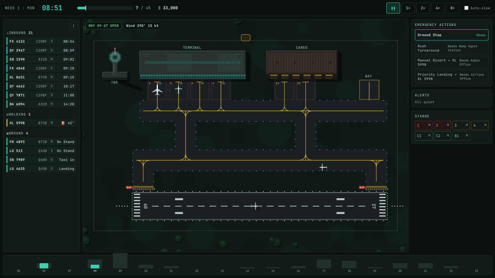
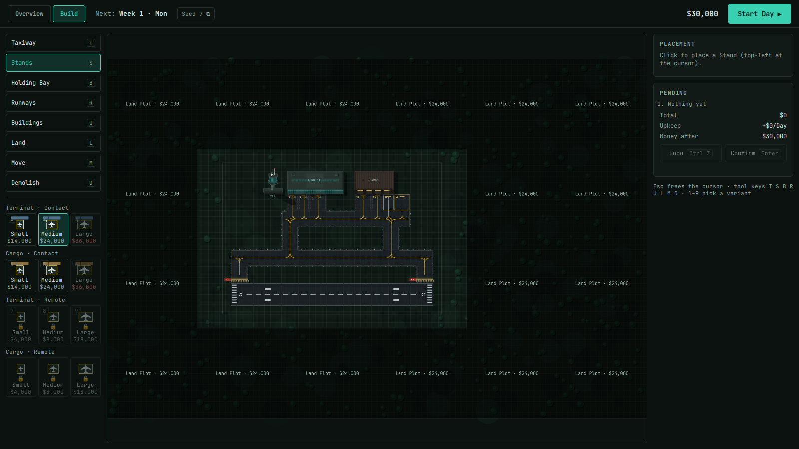
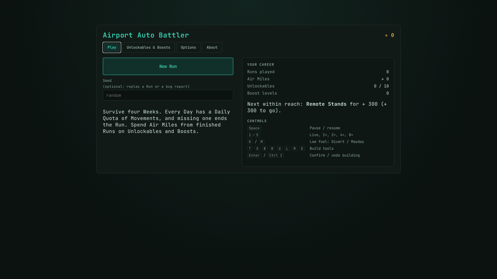
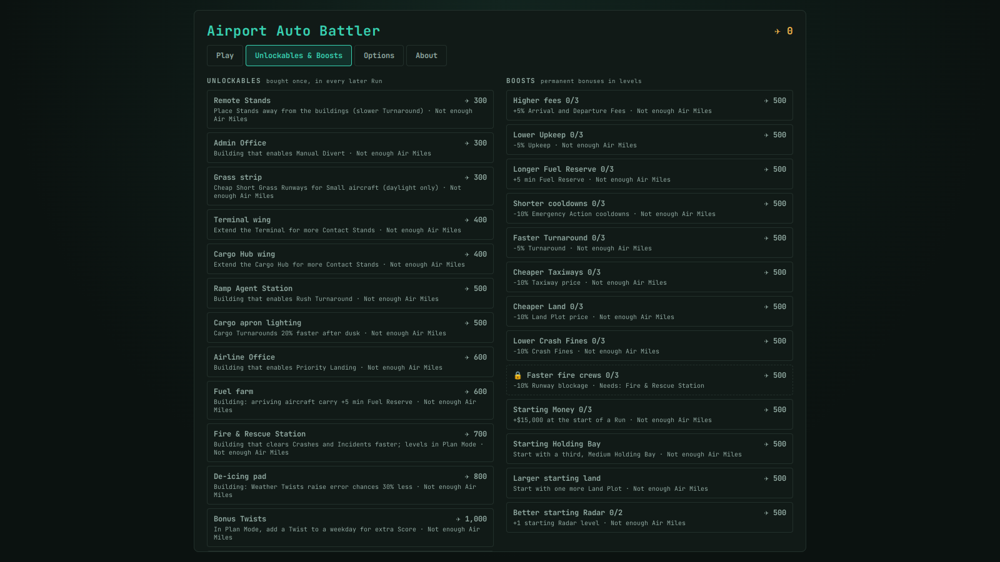
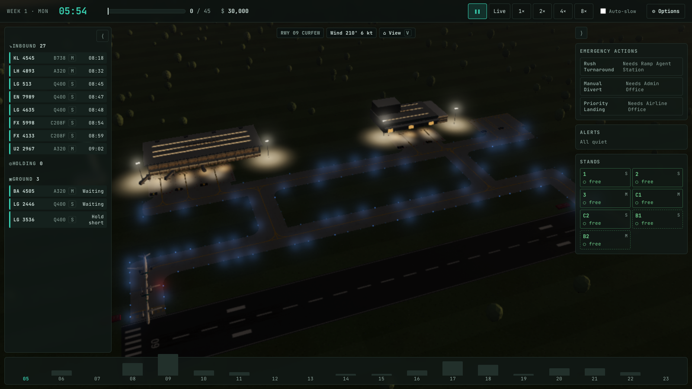
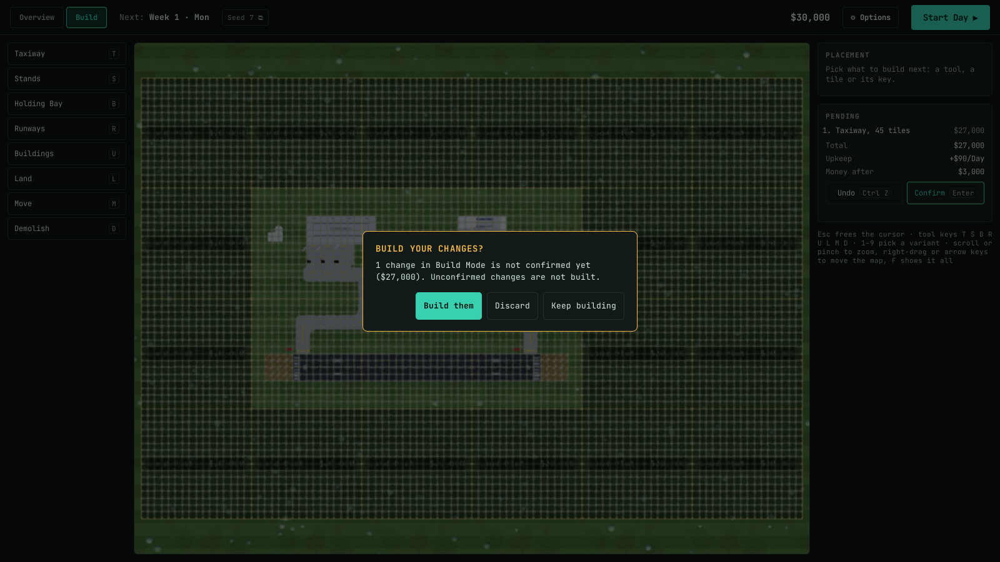

# Airport Auto Battler

A browser roguelite where you build and grow an airport through Days of traffic until you miss a Daily Quota.

**▶ Play it in the browser: https://felixs.github.io/airrough-like/**

Or run it yourself with Docker (images for Intel/AMD `linux/amd64` and ARM `linux/arm64`, e.g. a Raspberry Pi):

```bash
docker run -d -p 8080:80 --name airport-auto-battler ghcr.io/felixs/airrough-like:latest
```

Then open http://localhost:8080. Versions and their images are listed under [Releases](https://github.com/Felixs/airrough-like/releases).

## Screenshots

| | |
|---|---|
|  |  |
| **Live Day**: the ATC Tower handles the traffic; you watch the Quota, fuel and Alerts | **Plan Mode**: Forecast, Run Calendar with Twists, upgrades |
|  |  |
| **Build Mode**: pick Stands, Runways and buildings from priced tiles; draw Taxiways, buy Land | **Day report**: money, traffic and safety at a glance |
|  |  |
| **Main Menu** | **Unlockables & Boosts** bought with Air Miles |
|  |  |
| **Dawn**: the day–night cycle, with navigation, beacon and landing lights on the aircraft | **Build or discard**: leaving Build Mode or starting the Day with unconfirmed changes asks first |

The screenshots are taken automatically from the real game by the [Screenshots workflow](.github/workflows/screenshots.yml) whenever the UI changes (`scripts/screenshots.mjs`).

- Domain language: [`CONTEXT.md`](CONTEXT.md)
- Decisions: [`docs/adr/`](docs/adr). PixiJS draws the game; all game logic lives in a pure TypeScript simulation.
- Design notes and prototype findings: [`docs/`](docs)
- Work is tracked as GitHub issues labelled `ready-for-agent`

## Develop

```bash
npm install
npm run dev        # local dev server
npm test           # simulation tests (Vitest)
npm run typecheck
npm run build      # production build into dist/
```

## Layout

- `src/sim/`: the simulation. No rendering or DOM imports; fixed 15-second steps; unit-tested.
- `src/render/`: PixiJS views that draw the simulation's state.
- `src/ui/`: DOM panels (top bar etc.).

## Deploy and release

- Every push to `main` runs CI (typecheck, tests, build), publishes the game to GitHub Pages and, when configured, pushes a `latest` image to the GitLab registry for the Raspberry Pi ([`docs/deploy-raspberry-pi.md`](docs/deploy-raspberry-pi.md)).
- **Releases:** bump `version` in `package.json`, merge, then run **Actions → Release → Run workflow** on `main` (or push a tag `v0.2.0`). The [Release workflow](.github/workflows/release.yml) builds `linux/amd64` + `linux/arm64` images, pushes them to `ghcr.io/felixs/airrough-like` (`0.2.0`, `0.2`, `latest`) and creates a GitHub Release linking them and the browser version.
