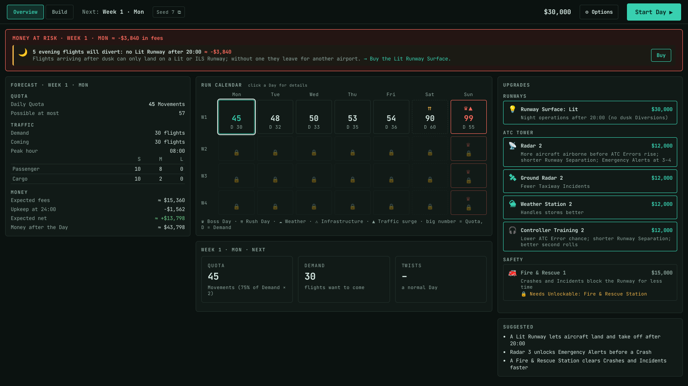
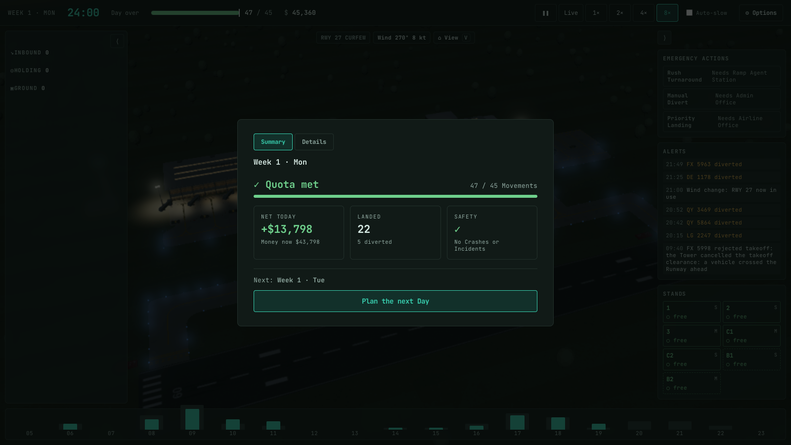

# Airport Auto Battler

A browser roguelite where you build and grow an airport through Days of traffic until you miss a Daily Quota.

## Screenshots

| | |
|---|---|
|  |  |
| **Live Day**: the ATC Tower handles the traffic; you watch the Quota, fuel and Alerts | **Plan Mode**: Forecast, Run Calendar with Twists, upgrades |
|  |  |
| **Build Mode**: Taxiways, Stands, Runways, buildings and Land | **Day report**: money, traffic and safety at a glance |
|  |  |
| **Main Menu** | **Unlockables & Boosts** bought with Air Miles |

The screenshots are taken automatically from the real game by the [Screenshots workflow](.github/workflows/screenshots.yml) whenever the UI changes (`scripts/screenshots.mjs`).

- Domain language: [`CONTEXT.md`](CONTEXT.md)
- Decisions: [`docs/adr/`](docs/adr). PixiJS draws the game; all game logic lives in a pure TypeScript simulation.
- Design notes and prototype findings: [`docs/`](docs)
- Work is tracked as GitHub issues labelled `ready-for-agent`

## Develop

```bash
npm install
npm run dev        # local dev server
npm test           # simulation tests (Vitest)
npm run typecheck
npm run build      # production build into dist/
```

## Layout

- `src/sim/`: the simulation. No rendering or DOM imports; fixed 15-second steps; unit-tested.
- `src/render/`: PixiJS views that draw the simulation's state.
- `src/ui/`: DOM panels (top bar etc.).

## Deploy

Every push to `main` runs CI (typecheck, tests, build) and publishes a Docker image (nginx serving the game, arm64 + amd64) to a private GitLab Container Registry. A Raspberry Pi on the home network runs it. Setup: [`docs/deploy-raspberry-pi.md`](docs/deploy-raspberry-pi.md).
